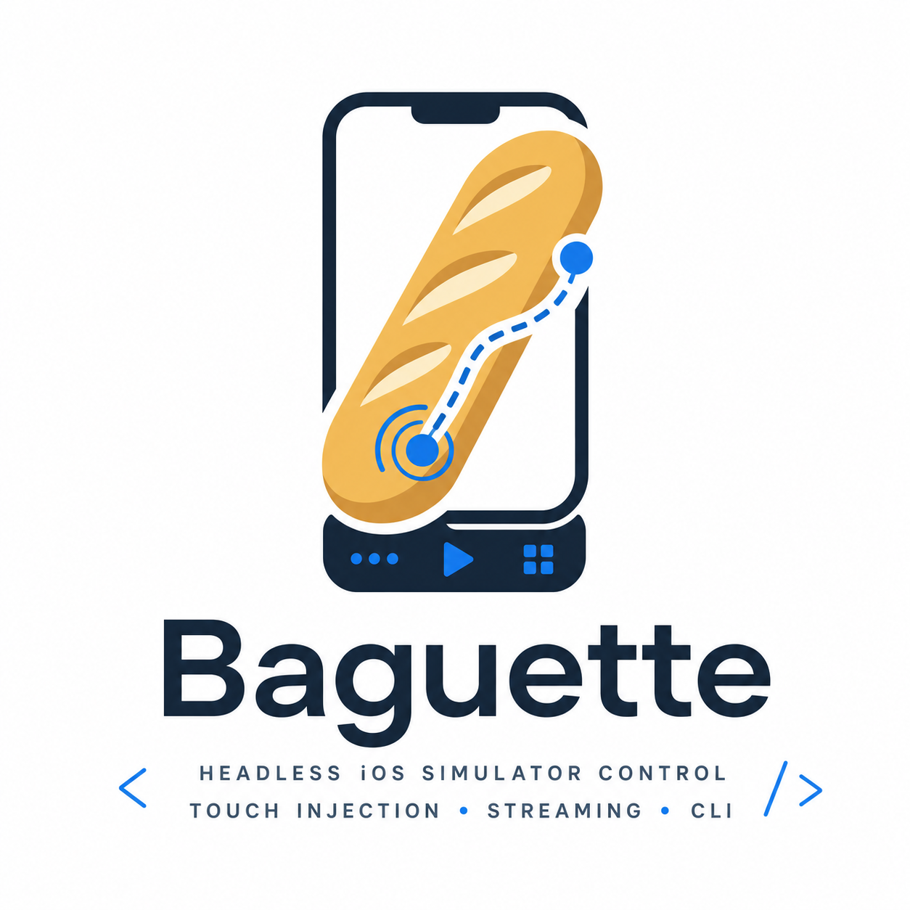

<p align="center">
  
</p>

<h1 align="center">Baguette</h1>

<p align="center"><em>Bon appétit.</em></p>

<p align="center">
  Headless iOS Simulator manager + host-side input injection for iOS 26.
</p>

<p align="center">
  <a href="https://github.com/tddworks/baguette/actions/workflows/ci.yml"></a>
  <a href="https://codecov.io/gh/tddworks/baguette"></a>
  <a href="https://github.com/tddworks/baguette/releases/latest"></a>
  <a href="LICENSE"></a>
  
  
  
</p>

A single Swift CLI — **`baguette`** — plus a self-contained web UI that
gives you full headless control of an iOS simulator without opening
Xcode or `Simulator.app`. Boot devices, stream their screens at 60 fps,
dispatch taps, swipes, multi-finger and system gestures, keyboard and
hardware buttons, read the accessibility tree, tail the unified log,
take screenshots and recordings, and feed the simulator a camera,
a location, motion and a slower network — on iOS 26 and later, where
the 5-argument HID call `idb` and `AXe` rely on stopped working.

## Demo

https://github.com/user-attachments/assets/e904413f-16bb-4b3d-86d5-162333403cee

https://github.com/user-attachments/assets/c49c9f4b-0e4b-47ea-9272-3223b1ac7739

https://github.com/user-attachments/assets/65dc62ee-f0c7-48fb-9c57-5bd267c8c02f

> The raw clip lives at [`assets/demo.mp4`](assets/demo.mp4) — drag
> it into a GitHub web edit of this README to upload as a CDN-hosted
> video and replace the line above with the auto-generated URL.

## Install

```bash
brew install baguette
```

Apple Silicon with Xcode 26 — `baguette` links the private SimulatorKit /
CoreSimulator frameworks that ship with Xcode. If Homebrew complains about
Rosetta, see [Troubleshooting](CONTRIBUTING.md#troubleshooting-the-homebrew-install).

## Quick start

```bash
baguette serve                          # web UI at http://127.0.0.1:8421/simulators
open http://localhost:8421/farm         # every booted simulator side by side

baguette list
baguette boot --udid <UDID>
baguette tap  --udid <UDID> --x 219 --y 478 --width 438 --height 954
baguette describe-ui --udid <UDID>      # what's on screen, frames in device points

# an App Store-sized screenshot, and a 10-second clip at the same size
baguette screenshot --udid <UDID> --size appstore-6.9 --output hero.png
baguette record     --udid <UDID> --size appstore-6.9 --duration 10 --output demo.mp4
```

Coordinates are device points, and `--width` / `--height` are the screen
size in points (`baguette chrome layout --udid <UDID>` tells you). For a
long-lived session, pipe JSON gestures into `baguette input` — see the
[wire protocol](docs/wire.md).

## Sponsors

Apps that use and support Baguette development:

<table>
  <tbody>
    <tr>
      <td width="160" align="center">
        <a href="https://air.build" target="_blank">
          
          <br>
          <b>AirBuild</b>
        </a>
      </td>
      <td>Your idea. Your AI team. A working native iOS app. Build the app. AirBuild handles App Review. Specialized agents submit, respond, fix, and resubmit—automatically.</td>
    </tr>
  </tbody>
</table>

## What it covers

| Area | What you can do |
|---|---|
| Touches & gestures | Tap, swipe, pinch, pan, streamed one- and two-finger touches, home-indicator and pull-down system gestures → [touches](docs/features/touches/README.md), [double-tap](docs/features/double-tap/README.md) |
| Buttons & keyboard | Home, lock, volume, action, Watch crown; keystrokes, typed text, paste and clipboard sync → [buttons](docs/features/buttons/README.md), [keyboard](docs/features/keyboard/README.md), [paste](docs/features/paste/README.md) |
| Screen capture | Screenshots, recordings, frame streams to stdout, one output-size vocabulary, 3D device renders → [screenshot](docs/features/screenshot/README.md), [stream](docs/features/stream/README.md), [recording](docs/features/recording/README.md), [capture-size](docs/features/capture-size/README.md), [3d-rendering](docs/features/3d-rendering/README.md) |
| Accessibility | The on-screen AX tree as JSON, hit-testing, a hover inspector in the browser → [accessibility](docs/features/accessibility/README.md), [ax-inspector](docs/features/ax-inspector/README.md), [ax-hit-test-sweep](docs/features/ax-hit-test-sweep/README.md) |
| Logs | Live unified log, filtered by level, predicate or bundle id → [logs](docs/features/logs/README.md) |
| Web UI | Focus-mode page with bezel, a multi-device farm, a JS SDK for your own page → [device-farm](docs/features/device-farm/README.md), [chrome-bezel](docs/features/chrome-bezel/README.md), [baguette-sdk](docs/features/baguette-sdk/README.md), [serve routes](docs/serve.md) |
| Device lifecycle | Boot, shut down, repair input after Xcode 27's Device Hub → [boot](docs/features/boot/README.md), [device-hub](docs/features/device-hub/README.md) |
| Device settings | Orientation, appearance, contrast, text size, status bar, shake → [orientation](docs/commands.md#baguette-orientation), [interface](docs/features/interface/README.md), [status-bar](docs/features/status-bar/README.md), [shake](docs/features/shake/README.md) |
| Simulated world | Mac webcam or a file as the camera, GPS and routes, CoreMotion, network conditioning → [camera](docs/features/camera/README.md), [location](docs/features/location/README.md), [motion](docs/features/motion/README.md), [network](docs/features/network/README.md) |
| Apps & files | Deep links and URL schemes, drag-and-drop app install and Photos → [deep-links](docs/features/deep-links/README.md), [file-upload](docs/features/file-upload/README.md) |
| Other screens | CarPlay and paired Watch, iPhone Duo and its hinge, a physical iPhone (preview) → [companion-screens](docs/features/companion-screens/README.md), [iphone-duo](docs/features/iphone-duo/README.md), [hinge](docs/features/hinge/README.md), [device-twin](docs/features/device-twin/README.md) |
| Plugins | Add panels and commands from a trusted bakery; they run as subprocesses → [plugins](docs/features/plugins/README.md) |

## More

[Docs index](docs/README.md) · [Commands](docs/commands.md) ·
[Wire protocol](docs/wire.md) · [Serve routes](docs/serve.md) ·
[Architecture](docs/ARCHITECTURE.md) · [Contributing](CONTRIBUTING.md) ·
[Changelog](CHANGELOG.md)

## License

Apache License 2.0 — see [`LICENSE`](LICENSE).
